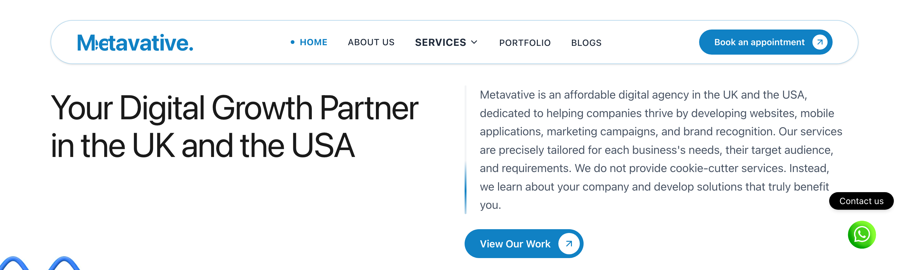

# Metavative Website

The marketing website for Metavative, the UK and US software agency where I work as Team Lead.

Live site: https://metavative.com

## What it does
The site presents the agency, its services, and its portfolio, and lets visitors book an appointment. It is fast, responsive, and SEO friendly.

## My role
I help build and maintain the site, working across the frontend and backend.

## Tech
Laravel, React, Vite, Tailwind CSS.

## Note
This is the website of the agency where I work. The source code is private.
